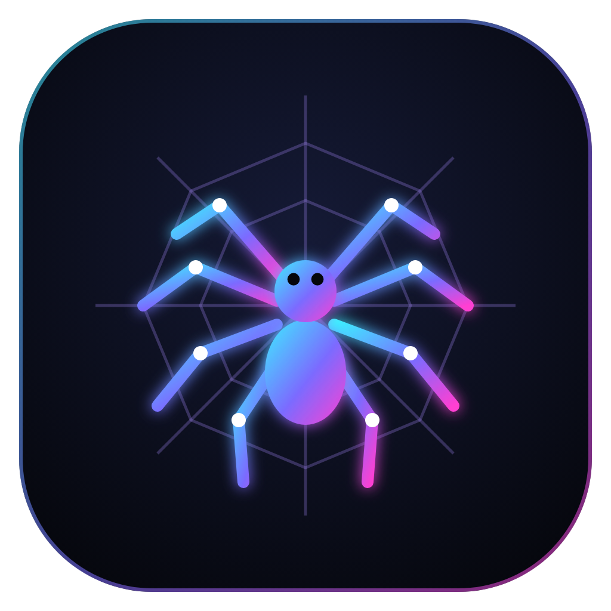

<p align="center">
  
</p>

<h1 align="center">Aracne</h1>

<p align="center">
  <b>Arañas digitales que leen contigo.</b><br>
  Pulsa <kbd>Ctrl</kbd> + <kbd>Shift</kbd> + <kbd>Espacio</kbd> (en Mac <kbd>⌘</kbd> + <kbd>⇧</kbd> + <kbd>Espacio</kbd>) sobre cualquier página, PDF o documento<br>
  y unas arañas recorrerán tu pantalla para verificar fuentes, encontrar plazos, resumir, explicar imágenes y ayudarte a estudiar.
</p>

<p align="center">
  <a href="https://hebexort771.github.io/Aracne/"><b>Página web</b></a> ·
  <a href="../../releases/latest"><b>Descargar</b></a> ·
  Gratis para Windows, Mac y Linux
</p>

---

## Descargar

| Sistema | Instalador |
|---|---|
| Mac con chip M (M1, M2, M3, M4…) | [`Aracne-mac-arm64.dmg`](../../releases/latest/download/Aracne-mac-arm64.dmg) |
| Mac con Intel | [`Aracne-mac-x64.dmg`](../../releases/latest/download/Aracne-mac-x64.dmg) |
| Windows 10 / 11 | [`Aracne-windows-x64.exe`](../../releases/latest/download/Aracne-windows-x64.exe) |
| Linux | [`Aracne-linux-x64.AppImage`](../../releases/latest/download/Aracne-linux-x64.AppImage) · [`.deb`](../../releases/latest/download/Aracne-linux-x64.deb) |

La app todavía no está firmada por Apple ni por Microsoft, así que la primera vez:

- **Mac:** si dice que no puede comprobarla → *Ajustes del Sistema → Privacidad y seguridad → Abrir igualmente*. Para usar el atajo, activa Aracne en *Grabación de pantalla* y reinicia la app.
- **Windows:** si aparece "Windows protegió tu PC" → *Más información → Ejecutar de todas formas*.
- **Linux:** da permiso de ejecución al `.AppImage` (clic derecho → Propiedades).

## Qué hace

Cada araña tiene un trabajo:

| Araña | Qué hace | ¿Necesita IA? |
|---|---|---|
| **Fuentes** | Revisa DOI, ISBN, PubMed, PMC, arXiv y enlaces. Detecta artículos **retractados**, DOI inventados y enlaces rotos (con copia en archive.org). Copia tu bibliografía en **APA 7**. | No |
| **Plazos** | Encuentra exámenes, entregas, pagos e inscripciones y los manda a Google Calendar o a un archivo `.ics`. | No |
| **Contexto** | Al pasar el cursor sobre "Figura 3", "[12]", una nota o una sigla, una araña te trae lo que menciona. | No |
| **Memoria** | Recuerda lo que lees (solo en tu computadora) y te muestra conexiones con lecturas anteriores. | No |
| **Lectura** | Tiempo de lectura, nivel de dificultad (INFLESZ / Flesch), oraciones más difíciles y modo enfoque. | No |
| **Resumen** | Ideas clave, secciones, glosario y preguntas de repaso; cada idea tiene un hilo al párrafo de donde sale. Sin IA hace un resumen extractivo. | Sí (opcional) |
| **Preguntar** | Preguntas sobre el documento con respuestas que citan los párrafos. | Sí |
| **Estudiar** | Tarjetas de memoria y quiz tipo examen, exportables a Anki. | Sí |
| **Visión** | La **lupa araña**: encierra un gráfico, una fórmula (la escribe en LaTeX), una tabla o una foto y te la explica. Sin IA, copia el texto de la zona con OCR. | Sí (opcional) |
| **Letra pequeña** | Marca las trampas de contratos, matrículas y suscripciones. | Sí |

### Dos formas de usarla

1. **Sobre cualquier aplicación** con el atajo: toma una captura, la invierte con una línea de escaneo, la lee con OCR en tu computadora y suelta las arañas. `Esc` para salir.
2. **En el lector**: pega un enlace o arrastra un PDF, Word (`.docx`), imagen, `.txt`, `.md` o `.html`.

### IA gratis

- **Ollama** (en tu computadora, sin internet): instala [Ollama](https://ollama.com/download) y ejecuta `ollama pull gemma3`. Aracne lo detecta solo.
- **Google Gemini** (gratis con límites): crea una clave en [aistudio.google.com/apikey](https://aistudio.google.com/apikey) y pégala en *Ajustes*.
- También funciona con **Claude**, **OpenAI** y servicios compatibles (Groq, OpenRouter, LM Studio…).

Las claves se guardan cifradas en tu computadora.

## Privacidad

El OCR, la búsqueda de fechas, siglas y referencias, y la memoria funcionan sin internet. Para verificar fuentes, Aracne consulta catálogos abiertos (Crossref, DataCite, PubMed, arXiv, Open Library, Google Books y archive.org) solo con los identificadores que encuentra. Si usas una IA en la nube, solo se envía el texto o la imagen que pides analizar.

---

## Para desarrolladores

Requiere Node.js 22.

```bash
npm install
npm run dev        # Vite + Electron con recarga
npm test           # pruebas de los extractores (fechas, fuentes, APA, lectura…)
npm run dist       # instaladores para tu sistema en release/
```

### Estructura

```
electron/            proceso principal
  main.js            ventanas, atajo global, bandeja, captura de pantalla, IPC
  ai.js              Ollama, Gemini, Claude, OpenAI/compatibles
  sources.js         verificación de DOI/ISBN/PubMed/arXiv/enlaces
  memory.js          memoria de lecturas (local)
  settings.js        ajustes; claves cifradas con safeStorage
  web.js             carga páginas web completas (incluye las que usan JavaScript)
src/
  spiders/engine.js  motor de arañas: patas con cinemática inversa, hilos, recuadros neón, etiquetas
  core/              extractores sin IA (fuentes, fechas, siglas, referencias), APA 7, .ics, OCR, lectura
  ai/tasks.js        resumen con párrafos citados, preguntas, estudio, visión, letra pequeña
  panel/panel.js     panel lateral (compartido por el lector y la capa de pantalla)
  lector/            lector de web, PDF (pdf.js), Word (mammoth), texto e imágenes
  overlay/           capa que aparece con el atajo
docs/                página web (GitHub Pages)
.github/workflows/   compila los instaladores al publicar una versión
```

### Publicar una versión

1. Sube los cambios a `main`.
2. En GitHub → **Releases → Draft a new release** → etiqueta `v1.0.1` (o la que siga) → **Publish release**.
3. GitHub Actions compila Mac, Windows y Linux (unos 15 minutos) y adjunta los instaladores.

## Licencia

[MIT](LICENSE) © 2026 Heber Gomez
